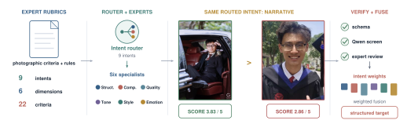
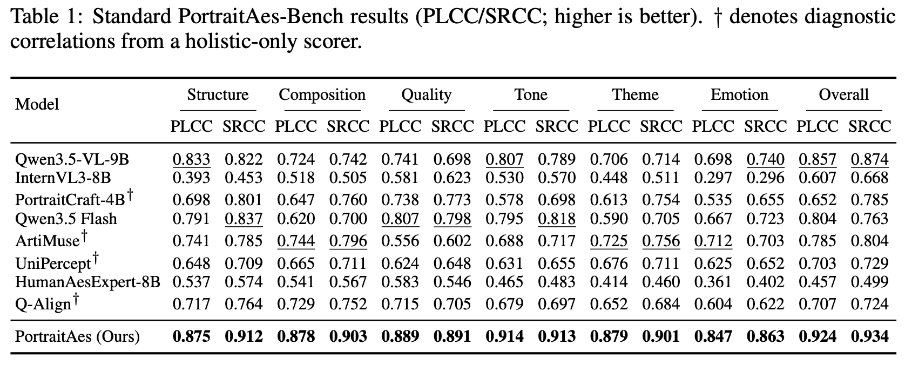
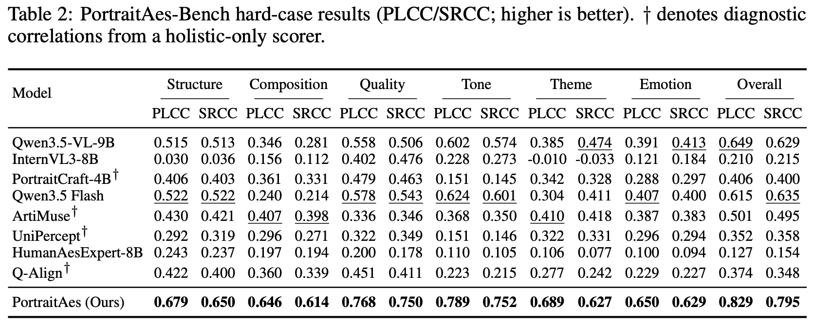
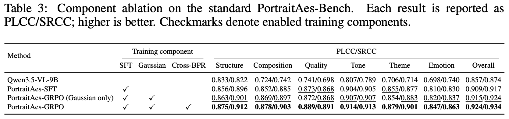
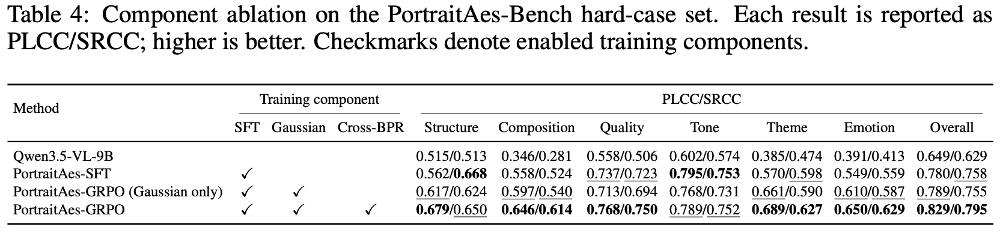
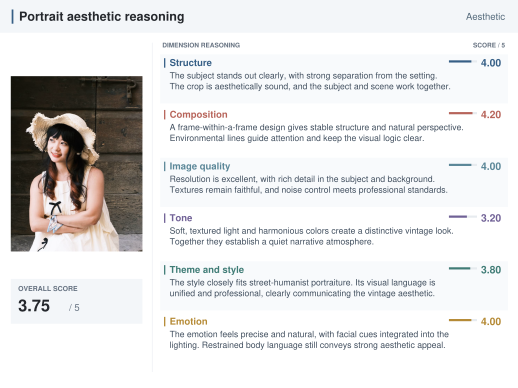
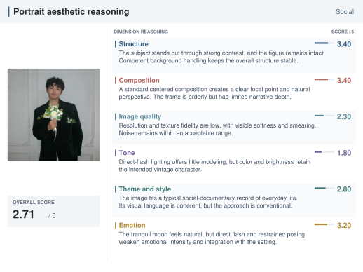

<div align="center">

# PortraitAes: Intent-Conditioned Structured Portrait Aesthetics Assessment

<a href="https://arxiv.org/abs/2610.05010" target="_blank">
  
</a>
<a href="https://portraitaes.github.io/" target="_blank">
  
</a>
<a href="https://huggingface.co/Qwen/Qwen3.5-9B" target="_blank">
  
</a>

**Junzhou Xie**<sup>1,2,‡</sup>, **Haozhong Xiong**<sup>2,‡</sup>,
**Xunyun Tian**<sup>2</sup>, **Kaile Du**<sup>1</sup>,
**Tianchen Yu**<sup>2</sup>, **Qiang Li**<sup>2</sup>,
**Wei Liu**<sup>2</sup>, **Jiaming Liu**<sup>2</sup>,
**Ruihua Huang**<sup>2</sup>, **Yang Shi**<sup>2,&#42;,†</sup>,
**Guangcan Liu**<sup>1,&#42;</sup>

<sup>1</sup>Southeast University &nbsp;&nbsp; <sup>2</sup>Qwen Business Unit of Alibaba<br>
<sup>‡</sup>Equal contribution &nbsp;&nbsp; <sup>&#42;</sup>Co-corresponding authors &nbsp;&nbsp; <sup>†</sup>Project lead<br>
[newsy0106@gmail.com](mailto:newsy0106@gmail.com) · [guangcanliu@seu.edu.cn](mailto:guangcanliu@seu.edu.cn)

</div>

<p align="center">
  <strong>If you find PortraitAes useful, please consider giving this repository a star ⭐.</strong>
</p>

<p align="center">
  
</p>
<p align="center"><em>PortraitAes routes each portrait by photographic intent and produces structured, specialist-grounded aesthetic assessments.</em></p>

## 🔥 News & Updates

- **[Oct 04, 2026] Paper Release.** PortraitAes is now available on [arXiv](https://arxiv.org/abs/2610.05010).

## 🚀 Quick Start

### Installation

Create a Conda environment and install PortraitAes:

```bash
conda create -n portraitaes python=3.12 -y
conda activate portraitaes
cd PortraitAes
pip install -e ".[train,inference]"
```

### Inference

Prepare one portrait per JSONL line:

```json
{"id": "portrait-001", "image": "/path/to/portrait.jpg"}
```

Download the PortraitAes model weights, set `MODEL_PATH` to the local model
directory, and run:

```bash
MODEL_PATH=/path/to/PortraitAes \
GPU_IDS=0,1,2,3 \
bash scripts/infer_local.sh /path/to/eval.jsonl --max-new-tokens 1024
```

The launcher runs PyTorch/Transformers inference directly, shards the input
across the selected GPUs, and supports resuming an existing run.

## 🌟 Abstract

Portrait aesthetic assessment assigns comparable scores according to how
effectively human-centered images fulfill their photographic intent. These
scores support data filtering, candidate selection, and preference modeling in
image-generation pipelines. Existing methods typically predict a single
aesthetic score or use general-purpose MLLMs without conditioning on
photographic intent. This omission matters because the same blur, pose,
lighting, or framing choice may serve one photographic intent but undermine
another. These models thus learn context-agnostic aesthetic priors and yield
inconsistent, inaccurate, misleading judgments for portraits with distinct
photographic objectives. We introduce PortraitAes-Bench, an 11K-scale benchmark
that decomposes this task into intent-conditioned subjudgments. Expert-authored
rubrics define nine photographic intents, six first-level dimensions, and 22
secondary criteria. They support a structured pipeline for intent routing,
specialist assessment, verification, and score fusion. Following this
structure, we train PortraitAes with multi-task supervision. We then improve
score comparability through Gaussian score calibration and within-dimension
cross-image ranking. On the standard benchmark, PortraitAes achieves a Pearson
correlation of 0.924 and a Spearman rank correlation of 0.934. On the hard-case
set, its Pearson correlation is 0.829 and its Spearman rank correlation is
0.795. Across both sets, PortraitAes outperforms the evaluated general-purpose
MLLMs and specialized aesthetic baselines.

## 📊 PortraitAes-Bench

Each portrait contributes seven linked records: one intent-routing record and
six specialist records.

| Evaluation set | Images | Task records | Purpose |
|---|---:|---:|---|
| Standard | 1,600 | 11,200 | Broad intent and score coverage |
| Hard case | 1,000 | 7,000 | Image-disjoint, range-restricted fine-grained ranking |

The router assigns one of nine photographic intents: **functional, commercial,
narrative, aesthetic, social, artistic, hybrid, snapshot,** or **symbolic**.
The six specialists cover:

| Dimension | Criteria | Representative evidence |
|---|---:|---|
| Structure | 3 | Subject prominence, completeness, background harmony |
| Composition | 4 | Framing and space, perspective, leading lines, dynamism |
| Image quality | 3 | Sharpness, texture fidelity, noise and artifact tolerance |
| Tone | 4 | Light–dark organization, purity, brightness, harmony |
| Theme and style | 3 | Intent fit, visual consistency, originality |
| Emotion | 5 | Intent consistency, physiological cues, context, intensity, body language |

### Data construction

The portrait collection covers diverse photographic intents and includes real,
generated, and edited images. Domain experts define the nine intents, six
assessment dimensions, 22 secondary criteria, score anchors, semantic label
spaces, task boundaries, and veto/cap rules before annotation begins.

For each image, a shared high-capacity multimodal model executes seven
rubric-bound roles. The intent router first produces the photographic intent,
fusion weights, and visible routing evidence. Its context is then provided to
six specialists, each of which returns an independently parseable structured
record grounded in visible portrait evidence. This produces one routing record
and six specialist records per image.

<p align="center">
  
</p>
<p align="center"><em>Figure 2. Benchmark construction from expert rubrics to verified intent-conditioned targets.</em></p>

Before intent-weighted fusion, the records undergo schema, score-range, label,
and veto/cap consistency checks, followed by expert verification of rubric
consistency and boundary cases. The retained targets include routing decisions,
dimension and subcriterion scores, semantic labels, evidence-grounded
rationales, rule decisions, and the final intent-conditioned score. This design
supports both component-level diagnosis and end-to-end evaluation.

## 🏆 Main Results

PortraitAes consistently outperforms the evaluated general-purpose MLLMs and
specialized aesthetic models on both benchmark settings.

### Comparison with existing methods

<details open>
<summary><strong>Standard PortraitAes-Bench</strong></summary>

<p align="center">
  
</p>
</details>

<details>
<summary><strong>PortraitAes-Bench hard-case set</strong></summary>

<p align="center">
  
</p>
</details>

### Component ablation

<details open>
<summary><strong>Standard PortraitAes-Bench</strong></summary>

<p align="center">
  
</p>
</details>

<details>
<summary><strong>PortraitAes-Bench hard-case set</strong></summary>

<p align="center">
  
</p>
</details>

## 🖼️ Qualitative Examples

<details open>
<summary><strong>Structured predictions across portrait intents</strong></summary>

<p align="center">
  
</p>
<p align="center"><em>Figure 6. Structured predictions for twelve portraits across six intent categories, grouped by category and ordered by decreasing overall score. Colored bars show the six specialist scores.</em></p>
</details>

<details>
<summary><strong>Dimension-level explanation: aesthetic portrait</strong></summary>

<p align="center">
  
</p>
<p align="center"><em>Figure 7. Dimension-level aesthetic explanations for an aesthetic portrait with an overall score of 3.75.</em></p>
</details>

<details>
<summary><strong>Dimension-level explanation: social portrait</strong></summary>

<p align="center">
  
</p>
<p align="center"><em>Figure 8. Dimension-level aesthetic explanations for a social portrait with an overall score of 2.71.</em></p>
</details>

## 📤 Output Format

Inference writes one JSON object per line. The example below follows the
normalized case-export schema used for qualitative results. Image identifiers
and explanatory text are synthetic, and internal provenance fields such as
source filenames, source HTML paths, and spreadsheet row indices are omitted.

<details>
<summary>Example anonymized JSONL record</summary>

```json
{
  "case_id": "portrait-0001",
  "image": "images/portrait_0001.jpg",
  "category": "功能类",
  "category_code": "I",
  "score": 3.82,
  "score_max": 5,
  "score_type": "model_prediction",
  "model": "portraitaes-qwen3.5-9b",
  "dimension_scores": {
    "structure": 4.0,
    "composition": 4.1,
    "image_quality": 4.0,
    "tone": 2.8,
    "theme_style": 3.8,
    "emotion": 4.0
  },
  "weights": {
    "structure": 0.20,
    "composition": 0.20,
    "image_quality": 0.30,
    "tone": 0.15,
    "theme_style": 0.10,
    "emotion": 0.05
  },
  "category_evidence": [
    "The portrait prioritizes clear subject presentation and recognizability."
  ],
  "dimensions": {
    "structure": {
      "name": "结构",
      "score": 4.0,
      "weight": 0.20,
      "summary": "The subject is clearly presented with a coherent relationship to the setting.",
      "tags": [
        {"name": "完整性判定层", "value": "物理层"}
      ],
      "subcriteria": [
        {"name": "主体突出度", "score": 4.0, "reason": "The subject remains visually prominent."},
        {"name": "完整性", "score": 4.0, "reason": "The framing preserves the relevant body structure."},
        {"name": "人景关系", "score": 4.0, "reason": "The subject and background remain visually coherent."}
      ]
    },
    "composition": {
      "name": "构图",
      "score": 4.1,
      "weight": 0.20,
      "summary": "The framing is balanced and supports the intended presentation.",
      "tags": [
        {"name": "构图形式", "value": "中心构图"}
      ],
      "subcriteria": [
        {"name": "取景留白", "score": 4.0, "reason": "The surrounding space is controlled."},
        {"name": "透视", "score": 4.0, "reason": "Perspective distortion is limited."},
        {"name": "引导线", "score": 4.2, "reason": "Visual elements guide attention toward the subject."},
        {"name": "动势", "score": 4.2, "reason": "The pose creates a stable visual rhythm."}
      ]
    },
    "image_quality": {
      "name": "画质",
      "score": 4.0,
      "weight": 0.30,
      "summary": "Details are clear and artifacts do not distract from the subject.",
      "tags": [],
      "subcriteria": [
        {"name": "锐度", "score": 4.0, "reason": "Important facial and clothing details remain clear."},
        {"name": "纹理", "score": 4.0, "reason": "Textures are reproduced naturally."},
        {"name": "噪点", "score": 4.0, "reason": "Noise and compression artifacts are well controlled."}
      ]
    },
    "tone": {
      "name": "影调",
      "score": 2.8,
      "weight": 0.15,
      "summary": "The exposure is usable, although tonal separation is limited.",
      "tags": [
        {"name": "影调评估模式", "value": "color"},
        {"name": "黑白", "value": "否"}
      ],
      "subcriteria": [
        {"name": "光影", "score": 2.5, "reason": "The lighting provides limited facial modeling."},
        {"name": "色彩纯度", "score": 3.0, "reason": "Colors remain generally clean."},
        {"name": "明度", "score": 3.0, "reason": "The main subject is adequately exposed."},
        {"name": "和谐度", "score": 2.7, "reason": "The palette is serviceable but not strongly unified."}
      ]
    },
    "theme_style": {
      "name": "题材风格",
      "score": 3.8,
      "weight": 0.10,
      "summary": "The styling is consistent with a functional portrait.",
      "tags": [
        {"name": "题材编码", "value": "S1.1"},
        {"name": "大类流派", "value": "纪实记录流"},
        {"name": "子题材", "value": "生活自然态"}
      ],
      "subcriteria": [
        {"name": "题材契合", "score": 4.0, "reason": "The visual treatment matches the intended use."},
        {"name": "视觉一致性", "score": 4.0, "reason": "Styling choices remain internally consistent."},
        {"name": "独创性", "score": 3.4, "reason": "The presentation is effective but conventional."}
      ]
    },
    "emotion": {
      "name": "情绪",
      "score": 4.0,
      "weight": 0.05,
      "summary": "The expression and body language are natural and contextually appropriate.",
      "tags": [
        {"name": "情绪大类", "value": "社交"},
        {"name": "情绪标签", "value": "自然、平静"}
      ],
      "subcriteria": [
        {"name": "意图一致性", "score": 4.0, "reason": "The affect supports the photographic intent."},
        {"name": "生理真实性", "score": 4.0, "reason": "The expression appears natural."},
        {"name": "语境融合", "score": 4.0, "reason": "The emotion fits the surrounding context."},
        {"name": "情绪浓度", "score": 3.8, "reason": "The emotional signal is clear but restrained."},
        {"name": "肢体语言", "score": 4.2, "reason": "The pose supports the perceived affect."}
      ]
    }
  },
  "router_output": {
    "photo_type": {
      "weight_category": "I",
      "weight_category_name": "功能类"
    },
    "evidence": [
      "The framing and presentation prioritize recognizability and practical use."
    ],
    "is_reject": false,
    "reject_reason": null,
    "reject_detail": null,
    "weights_used": {
      "structure": 0.20,
      "composition": 0.20,
      "image_quality": 0.30,
      "tone": 0.15,
      "theme_style": 0.10,
      "emotion": 0.05
    }
  },
  "rank_in_category": 1
}
```

</details>

The released inference pipeline preserves each source record and appends its
raw structured result under `portraitaes_result`. The normalized case-export
format above flattens the final category, score, weights, specialist summaries,
tags, and subcriteria for presentation. Add `--include-raw-predictions` to
retain raw model responses, or use `--exclude-dimensions` to omit selected
specialists and renormalize the remaining fusion weights.

## 🗂️ Data Format

Training data use JSONL in the ms-swift multimodal message format.

### SFT records

The SFT corpus used in the paper has three top-level fields: `images`,
`messages`, and `meta`. Each row contains a system rubric, an image-only user
turn, and a serialized JSON target in the assistant turn. The following
synthetic example matches the released theme-and-style schema while anonymizing the image and
source metadata:

```json
{
  "images": ["images/portrait_0001.jpg"],
  "messages": [
    {
      "role": "system",
      "content": "<theme-and-style rubric prompt>"
    },
    {
      "role": "user",
      "content": "<image>"
    },
    {
      "role": "assistant",
      "content": "{\"subject_code\": \"S1.1\", \"subject_code_reason\": \"The portrait records a natural everyday moment.\", \"major_stream\": \"纪实记录流\", \"sub_subject\": \"生活自然态\", \"fit_score\": 4, \"fit_reason\": \"The presentation matches the intended subject.\", \"visual_consistency\": 4, \"visual_consistency_reason\": \"The visual elements are stylistically coherent.\", \"originality\": 3, \"originality_reason\": \"The treatment is effective but conventional.\", \"veto_applied\": false, \"veto_reason\": null, \"cap_applied\": false, \"cap_reason\": null, \"theme_style_score\": 3.8, \"theme_style_summary\": \"The portrait presents a coherent documentary style.\"}"
    }
  ],
  "meta": {
    "aesthetics_dimension": "theme_style",
    "source_file": "anonymized_source.jsonl"
  }
}
```

`messages[*].content` remains a string, including the assistant JSON target.
The public prompts under `src/portraitaes/inference/prompts/` define the
corresponding output schemas. The seven task identifiers are:

| `meta.aesthetics_dimension` | Primary structured output |
|---|---|
| `type_agent` | Portrait intent, routing evidence, reject decision, and fusion weights |
| `structure` | Subject prominence, completeness, background harmony, and structure score |
| `composition` | Composition form, framing, perspective, leading lines, dynamism, and composition score |
| `image_quality` | Sharpness, texture, noise/artifacts, and image-quality score |
| `tone` | Tone mode, light and shadow, purity, brightness, harmony, and tone score |
| `theme_style` | Subject taxonomy, fit, consistency, originality, and theme/style score |
| `emotion` | Emotion labels, intent consistency, physiological cues, context, intensity, body language, and emotion score |

The `meta.source_file` field is provenance metadata rather than model input. It
may be removed or replaced with an anonymized identifier before distribution.

### GRPO records

GRPO records omit the assistant turn because completions are sampled online.
The mixed seven-task loader recognizes:

| Field | Description |
|---|---|
| `aesthetics_dimension` | `type_agent` or one of the six specialist identifiers |
| `gt_score`, `gt_score_key` | Primary scalar target and its response key |
| `dimension_score_labels` | Specialist subcriterion targets |
| `gt_full_json` | Complete reference object when required by a reward |
| `weights_used` | Intent-conditioned fusion weights |
| Task-specific semantic fields | Subject code, composition form, tone mode, emotion category, and related labels |

For theme-and-style-only experiments, convert an SFT JSONL file with:

```bash
python tools/prepare_grpo_data.py \
  --src /path/to/sft_train.jsonl \
  --out /path/to/grpo_train.jsonl \
  --target 5000 \
  --seed 42
```

## 🛠️ Training

The repository provides scripts for supervised fine-tuning and rank-aligned
GRPO. Run them from the repository root after setting the model and dataset
paths.

### Supervised fine-tuning

```bash
MODEL_PATH=/path/to/Qwen3.5-9B \
DATASET_PATH=/path/to/sft_train.jsonl \
bash scripts/train_sft.sh portraitaes-sft
```

### Rank-aligned GRPO

```bash
MODEL_PATH=/path/to/Qwen3.5-9B \
SFT_ADAPTER=/path/to/portraitaes-sft/checkpoint-N \
DATASET_PATH=/path/to/grpo_train.jsonl \
bash scripts/train_grpo.sh portraitaes-grpo
```

## 📁 Repository Layout

```text
portraitaes/
├── assets/
├── environment.yml           # Reference Conda environment
├── pyproject.toml            # Package metadata and optional dependencies
├── scripts/
│   ├── train_sft.sh          # Single- and multi-node LoRA SFT
│   ├── train_grpo.sh         # Rank-aligned GRPO
│   └── infer_local.sh        # Sharded PyTorch/Transformers inference
├── src/portraitaes/
│   ├── sft/                  # SFT launcher, trainer, and JSONL adapter
│   ├── grpo/                 # GRPO launcher, rewards, and JSONL adapter
│   └── inference/            # Prompts, fusion pipeline, and PyTorch inference
├── tools/
│   └── prepare_grpo_data.py  # Theme/style GRPO data preparation
└── tests/
    └── test_inference_pipeline.py
```

The local `models/`, `outputs/`, `logs/`, and cache directories are excluded
from Git.

## ✏️ Citation

If you find PortraitAes useful, please cite:

```bibtex
@misc{xie2026portraitaesintentconditionedstructuredportrait,
  title={PortraitAes: Intent-Conditioned Structured Portrait Aesthetics Assessment},
  author={Junzhou Xie and Haozhong Xiong and Xunyun Tian and Kaile Du and Tianchen Yu and Qiang Li and Wei Liu and Jiaming Liu and Ruihua Huang and Yang Shi and Guangcan Liu},
  year={2026},
  eprint={2610.05010},
  archivePrefix={arXiv},
  primaryClass={cs.CV},
  url={https://arxiv.org/abs/2610.05010},
}
```

## 📄 License

The source code in this repository is licensed under the
[Apache License 2.0](LICENSE).

The PortraitAes model weights are derived from Qwen3.5-9B and remain subject
to the upstream Qwen3.5-9B license. Any model release must
retain the upstream license and attribution. Benchmark data and annotations
are not distributed in this repository and are not covered by the software
license.
